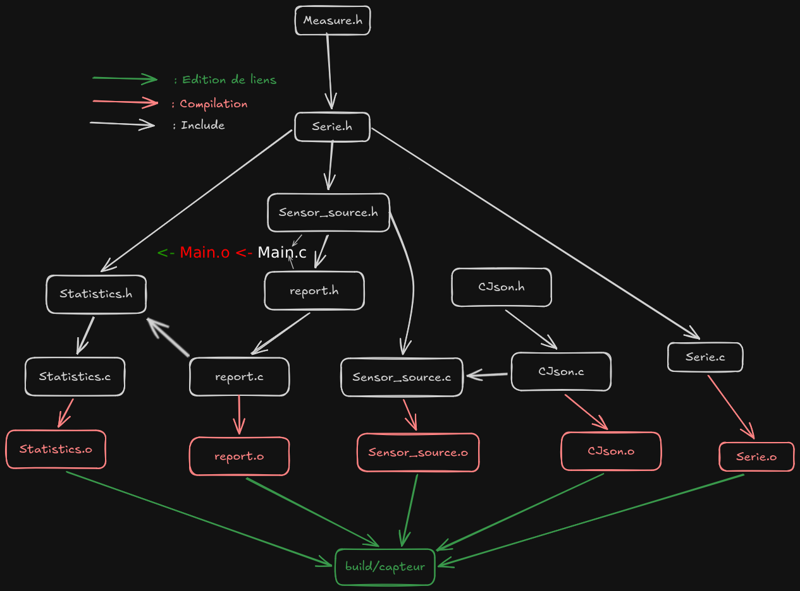

# Capteurs : analyser un historique de températures (C)

*Note : Ce projet a été initialement développé sur le GitLab de l'IUT puis importé ici pour archivage, d'où l'absence d'historique de commits. Le sujet et le code du dossier `capteurs-starter/provided/` (accès HTTP avec libcurl et lecture du JSON avec cJSON) ont été fournis par l'IUT. Le travail personnel porte sur les structures, les fonctions, la mémoire dynamique, les chaînes, les fichiers et les rapports.*

Programme en ligne de commande écrit en C11, développé pour la SAÉ C du BUT Informatique (IUT de Bordeaux). Il charge un historique de mesures de température et d'humidité intérieures et extérieures, calcule des statistiques sur les températures, affiche un rapport dans le terminal et produit une synthèse au format CSV. Les données viennent d'un flux JSON distant ou d'un fichier local.

## Contenu du dépôt

| Élément | Description |
|---------|-------------|
| `capteurs-starter/include/projet/` | Interfaces publiques (types et prototypes documentés) : `measure.h`, `series.h`, `statistics.h`, `report.h`, `sensor_source.h` |
| `capteurs-starter/src/` | Code personnel : `main.c`, `series.c`, `statistics.c`, `report.c` |
| `capteurs-starter/provided/` | Code fourni, non modifié : adaptation HTTP/JSON (`sensor_source.c`) et cJSON 1.7.19 (licence MIT) |
| `capteurs-starter/tests/` | Tests unitaires, script de test de la ligne de commande et jeu de données local (`data/sensors-history.json`) |
| `capteurs-starter/Makefile` | Compilation, tests, Valgrind et cppcheck |
| `arbre-de-dependances/arbreDép.png` | Schéma de l'arbre de dépendances du projet |

## Le programme

Chaque mesure contient une date, les températures intérieure et extérieure et les deux taux d'humidité. Seules les températures sont exploitées. Le programme calcule le minimum, le maximum et la moyenne de chacune, ainsi que l'écart moyen entre l'intérieur et l'extérieur.

```bash
./build/capteurs [--url URL | --file FICHIER] [--csv FICHIER] [--label TEXTE]
```

| Option | Rôle |
|--------|------|
| `--url URL` | Télécharge le JSON à cette adresse ; sans `--url` ni `--file`, l'adresse par défaut est utilisée |
| `--file FICHIER` | Lit un fichier JSON local, exclusif avec `--url` |
| `--csv FICHIER` | Fichier de sortie CSV (par défaut `rapport.csv`), une seule fois |
| `--label TEXTE` | Libellé du rapport (par défaut `Rapport capteurs`), une seule fois |

Les options peuvent être données dans n'importe quel ordre. Une option inconnue, incomplète ou dupliquée affiche l'usage et retourne le code `2`. Un libellé vide ou contenant une virgule, un guillemet ou un retour à la ligne est refusé (code `1`), car il serait écrit tel quel dans le CSV.

Exemple avec le jeu de données local :

```bash
./build/capteurs --file tests/data/sensors-history.json --csv rapport.csv --label "Mesures locales"
```

```text
Rapport : Mesures locales
Mesures: 6
Mise a jour: 2026-08-26T14:45:00.354680+02:00
Temperature interieure: min=27.00 max=27.60 moyenne=27.23
Temperature exterieure: min=27.00 max=27.50 moyenne=27.32
Ecart interieur-exterieur moyen: -0.08
```

Le fichier `rapport.csv` contient un en-tête et une ligne de synthèse (valeurs statistiques à deux décimales) :

```text
label,updated_at,count,indoor_minimum,indoor_maximum,indoor_average,outdoor_minimum,outdoor_maximum,outdoor_average,average_gap
Mesures locales,2026-08-26T14:45:00.354680+02:00,6,27.00,27.60,27.23,27.00,27.50,27.32,-0.08
```

## Fonctionnalités techniques

- **Série dynamique de mesures :** `series.c` alloue un tableau avec `malloc` à la première insertion (20 mesures), puis double sa capacité avec `realloc` quand il est plein. Si l'allocation échoue, la série reste utilisable et son contenu est conservé. `measure_series_clear` libère le tableau et remet la série à l'état vide.
- **Statistiques sans allocation :** `statistics.c` calcule le minimum, le maximum et la moyenne de la température demandée (`TemperatureKind`), puis l'écart moyen intérieur/extérieur. Les cas invalides (pointeur nul, série vide ou incohérente, grandeur inconnue) retournent `0`.
- **Libellé du rapport :** `report.c` valide le libellé, le copie avec `strlen`, `malloc` et `memcpy`, et le libère dans `sensor_report_options_clear`.
- **Rapports :** affichage lisible dans le terminal et export CSV avec vérification de chaque écriture (`fprintf`) et de la fermeture du fichier (`fclose`).
- **Arguments de la ligne de commande :** `main.c` analyse `argv` avec une boucle et `strcmp`, sans bibliothèque externe, et distingue les erreurs d'usage (code `2`) des erreurs de chargement ou d'écriture (code `1`).
- **Interfaces documentées :** chaque fonction publique a un contrat précis dans son en-tête (valeurs de retour, cas d'erreur, propriétaire de la mémoire), et le code fourni n'est utilisé que par `sensor_source.h`.
- **Compilation :** Makefile avec une règle par fichier objet et ses dépendances (en-têtes compris), en C11 avec `-Wall -Wextra -Wpedantic`. L'arbre de dépendances est détaillé dans `arbre-de-dependances/`.



## Tests et vérifications

Le dossier `tests/` contient cinq programmes de test en C et un script shell :

| Commande | Effet |
|----------|-------|
| `make test` | Exécute tous les tests |
| `make test-statistics` | Statistiques et écart moyen |
| `make test-series` | Série dynamique |
| `make test-source` | Chargement du jeu de données local |
| `make test-report` | Libellé et rapport terminal |
| `make test-csv` | Export CSV |
| `make test-cli` | Lancement complet : codes de sortie `0`, `1` et `2`, en-tête CSV, options invalides ou dupliquées, échec d'écriture dans `/dev/full` |
| `make memcheck` | Tests et lancement complet sous Valgrind (fuites et erreurs mémoire) |
| `make cppcheck` | Analyse statique de `src/` |

Sur la version de ce dépôt, `make test`, `make memcheck` et `make cppcheck` réussissent sans erreur ni fuite.

## Compétences mises en œuvre

Programmation en C sous Linux, structures, pointeurs et fonctions, gestion de la mémoire dynamique (`malloc`, `realloc`, `free`), chaînes de caractères (`string.h`), lecture et écriture de fichiers avec gestion des erreurs, ligne de commande, Makefile et compilation séparée, tests automatisés, débogage mémoire avec Valgrind, analyse statique avec cppcheck, lecture et respect de contrats d'interface, travail avec Git.

## Prérequis

- **Un compilateur C** (`gcc` ou `cc`) et **Make**
- **libcurl** (fichiers de développement)
- **Valgrind** et **cppcheck** pour les vérifications

Sous Debian ou Ubuntu :

```bash
sudo apt install build-essential libcurl4-openssl-dev valgrind cppcheck
```

## Installation et lancement

```bash
git clone https://github.com/Adrian-Styzinski/IUT-Capteurs.git
cd IUT-Capteurs/capteurs-starter
make check-tools
make
```

Lancement avec le fichier de données local, sans réseau :

```bash
./build/capteurs --file tests/data/sensors-history.json --csv rapport.csv --label "Mesures locales"
```

Sans option, le programme télécharge l'historique à l'adresse par défaut (`https://tribequa.org/assets/data/sensors-history.json`) et écrit `rapport.csv` dans le dossier courant.

## Auteurs

Adrian Styzinski et H. Marie dit Dalet.